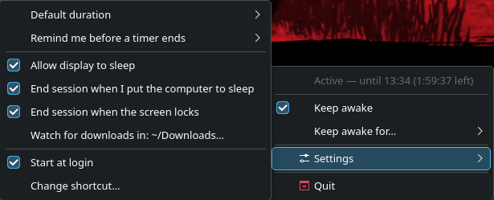

# ktamine

A tiny "keep awake" tray app for KDE Plasma (and other freedesktop desktops),
inspired by Amphetamine on macOS.



## Usage

**Left-click** the tray icon, or press **Meta+Shift+K**, to toggle keep-awake
on/off for the default duration (indefinitely unless changed in Settings).

**Right-click** for the menu:

- **Keep awake for…**
  - Indefinitely, 15 minutes – 8 hours, or a custom number of minutes
  - **Until a time…**: until a clock time (tomorrow if it has already passed)
  - **While an app is running…**: pick a running app; the session ends when it closes
  - **While downloading in ~/Downloads**: lasts while files in that folder (or its
    subfolders) are still being written. It ends once nothing has been written for a
    minute, or 5 minutes for partial downloads like `.part` and `.fdmdownload`, so
    finished and paused downloads both end it
- **Settings**
  - **Default duration** for left-click, the shortcut and `--on`
  - **Remind me before a timer ends**: a notification with +15 min … +2 hours buttons
  - **Allow display to sleep**: keep the computer awake but let the screen turn off
  - **End session when I put the computer to sleep** / **when the screen locks**
  - **Watch for downloads in**: the folder "While downloading" watches (default: ~/Downloads)
  - **Start at login**
  - **Change shortcut…**: opens System Settings > Shortcuts on ktamine's entry

The menu and tooltip show what's active, e.g. "Active — until 17:30 (1:23:45 left)".

### Command line

```sh
ktamine            # start the tray app
ktamine --toggle   # toggle keep-awake (starts the app if it isn't running)
ktamine --on       # turn on for the default duration
ktamine --off      # turn off
```

### Notes

- "While an app is running" finds apps through the systemd units Plasma starts
  them in, so it lists apps launched from the menu, taskbar, KRunner or autostart.
  Apps started from a terminal aren't listed, and games run inside Steam's unit.
- "Ends when the screen locks" includes automatic locks: on Wayland KDE can't
  report idle time, so manual and automatic locks can't be told apart.

## How it works

It uses the `org.freedesktop.PowerManagement.Inhibit` and
`org.freedesktop.ScreenSaver` D-Bus APIs (falling back to `systemd-inhibit`).
Inhibits are tied to the process, so quitting or crashing always releases them.

## Requirements

Python 3 and PyQt6 (`sudo pacman -S python-pyqt6`). KDE Plasma is needed for the
global shortcut, "Change shortcut…" and "While an app is running".

## Install

On Arch-based systems, build and install a package from the checkout:

```sh
makepkg -si
```

The package is built from the latest commit, not uncommitted changes. To update,
pull and run `makepkg -si` again.

Or install for the current user only, into `~/.local` (re-run after each update):

```sh
./install.sh              # make sure ~/.local/bin is on PATH
```

To try it without installing: `python3 -m ktamine`.

## Uninstall

Quit ktamine first, then:

```sh
sudo pacman -R ktamine      # if installed with makepkg
./install.sh --uninstall    # if installed with install.sh
```

`install.sh --uninstall` also removes the "Start at login" entry. With the package,
turn off **Settings → Start at login** before removing it, or delete
`~/.config/autostart/ktamine.desktop` afterwards.

Your settings stay in `~/.config/ktamine/`; delete that folder to remove them too.

## License

MIT, see [LICENSE](LICENSE).
